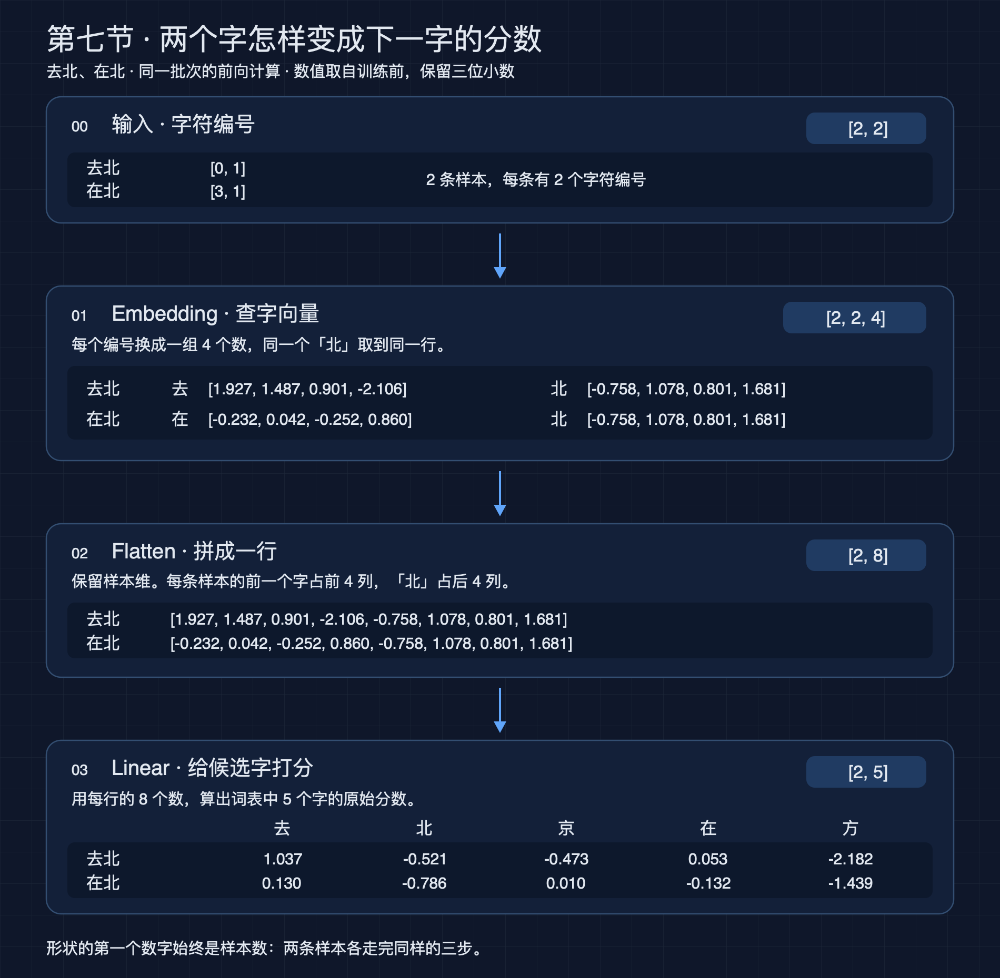
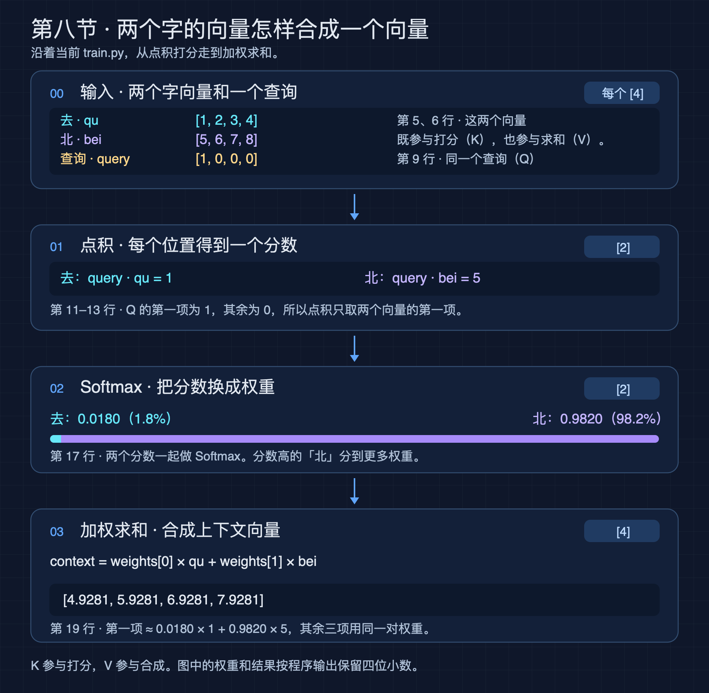
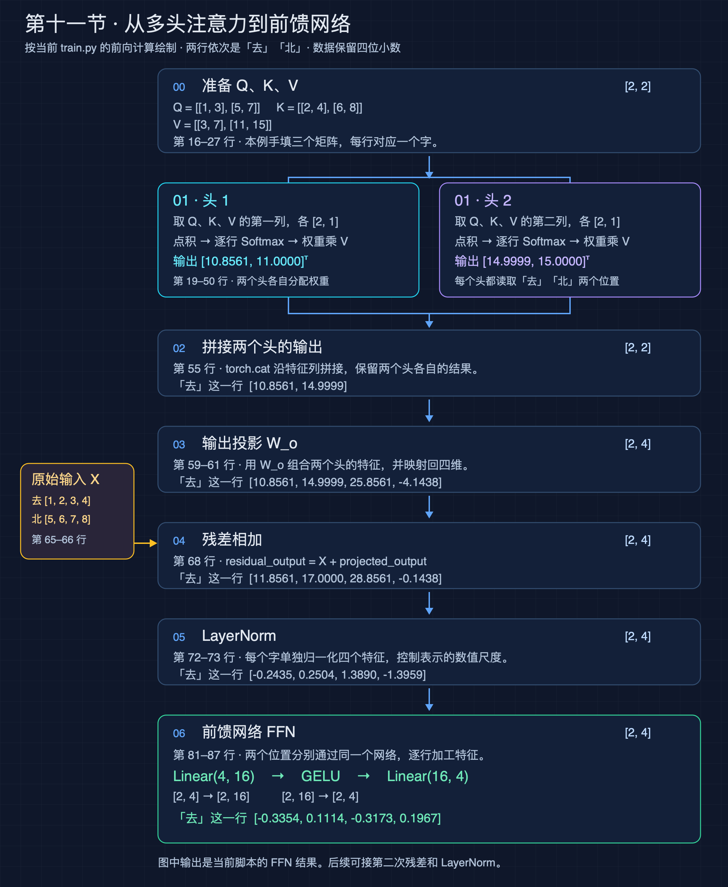

# PyTorch 学习笔记

按课次记录实验、关键公式和代码。目前整理到 Lesson 11，覆盖因果掩码、多头注意力、残差连接和前馈网络。后续课程继续追加在这里。反向传播、交叉熵和 LayerNorm 统一收录在本文后面的专题中。

## 专题索引

- [反向传播与梯度管理](#反向传播与梯度管理)
- [交叉熵与对数概率](#交叉熵与对数概率)
- [LayerNorm 层归一化](#layernorm-层归一化)

## Lesson 1 线性模型与梯度下降

[训练脚本](../lessons/01-linear-model/train.py)

用三个样本 $(1,5),(2,8),(3,11)$ 拟合 $y=3x+2$。模型 $f(x)=wx+b$ 有两个可训练的数。输入和目标各整理成 `[3, 1]`，每行对应一个样本。

手写更新的实验从 $w=2,b=1$ 出发，预测是 $[3,5,7]$。均方误差为：

$$
L=\frac{(3-5)^2+(5-8)^2+(7-11)^2}{3}=\frac{29}{3}.
$$

当前梯度约为 $(-13.3333,-6)$。学习率为 0.1 时，更新一次得到 $w\approx3.3333,b\approx1.6$，损失约为 0.145185。后来的脚本用 `nn.Linear(1, 1)` 管理权重和偏置，并用 SGD 执行更新。

| 代码 | 作用 |
| --- | --- |
| `requires_grad=True` | 让 PyTorch 追踪参数参与的运算 |
| `loss.backward()` | 用链式法则计算梯度，累加到参数的 `.grad` |
| `optimizer.step()` | 用当前梯度更新参数 |
| `optimizer.zero_grad()` | 清理已用过的梯度，准备下一次求导 |
| `torch.no_grad()` | 在更新或评测等数值计算中暂停记录求导图 |

用统一记号写，第 $k$ 次更新后参数是 $\theta_k$，梯度是 $g_k=\nabla L(\theta_k)$，下一次更新是 $\theta_{k+1}=\theta_k-\eta g_k$。在固定点沿负梯度走足够小的一步，一阶损失变化是 $-\eta\lVert g_k\rVert^2$。同一个实验里，学习率 0.01 学得慢，0.1 能收敛，0.2 曾让误差持续放大，最后出现 `nan`。

[反向传播和梯度清理的详细笔记](#反向传播与梯度管理)

## Lesson 2 非线性网络与评测

[训练脚本](../lessons/02-nonlinear-model/train.py)

把目标换成 $y=x^2$，在 $[-2,2]$ 上取 101 个等距训练点。直线模型最终学到近似水平线 $f(x)=1.36$，均方误差约为 1.479245。数据关于零对称，最佳直线的斜率为零，截距是这些 $x^2$ 的平均值。

把模型改成 `Linear(1, 16) → Tanh → Linear(16, 1)`，每个输入先得到 16 个数，逐个应用 `tanh`，再加权求和并加偏置，得到一个预测值。两层仿射变换直接相接仍可合成一个仿射变换，`Tanh` 让模型能够拟合曲线。

| 评测 | 结果 |
| --- | ---: |
| 固定种子，训练 1000 次后的训练 MSE | 0.00221237 |
| 100 个未参与训练的区间内中点 MSE | 0.00180599 |
| $x=0.37$，目标 0.136900 | 预测 0.135711 |
| $x=3.00$，目标 9.000000 | 预测 5.244933 |

曲线图显示，1000 次更新比 100 次更新更贴合训练区间内的抛物线。中点检查衡量的是区间内插值，$x=3$ 检查的是区间外外推。评测时固定参数，用 `model(inputs)` 计算预测并与目标比较。训练输出里显示的 `.grad` 是梯度，参数值要从 `model.weight`、`model.bias` 或 `named_parameters()` 读取。

## Lesson 3 小批量训练

[训练脚本](../lessons/03-mini-batch/train.py)

`TensorDataset(inputs, targets)` 按样本配对输入和答案。DataLoader 设置 `batch_size=16, shuffle=True` 后，每次遍历先打乱样本顺序，再分批。101 条数据分为 6 批各 16 条，加最后 1 批 5 条。

一个 **step** 是一次参数更新，一个 **epoch** 是完整遍历一次训练集。第 3 节每个 epoch 更新 7 次，10 个 epoch 更新 70 次。全批量训练在看完全部样本后更新一次。小批量训练在遍历中途就更新，因此后面的批次会用到新的参数。

每批损失使用不同的样本和参数状态，数值可以来回波动。要观察训练趋势，在一个 epoch 的所有更新完成后，用当时的参数统一计算全部 101 条样本的平均损失。

## Lesson 4 SGD 和 Adam 的对照

[训练脚本](../lessons/04-adam/train.py)

两组实验使用相同的模型、随机种子、数据和分批设置，各训练 100 个 epoch，也就是 700 次更新。初始整体 MSE 都约为 3.206586。

| 指标 | SGD，学习率 0.1 | Adam，学习率 0.01 |
| --- | ---: | ---: |
| 第 10 轮末的整体 MSE | 0.622965 | 1.211284 |
| 首次在轮末记录到 MSE ≤ 0.01 | 第 71 轮 | 第 65 轮 |
| 相邻两轮间 MSE 上涨次数 | 42 | 8 |
| 第 100 轮末的整体 MSE | 0.005023 | 0.005002 |

这个对照显示，两套配置的最终损失接近。SGD 在第 10 轮时更低，Adam 先达到所选阈值，轮与轮之间的上涨也更少。

SGD 用当前梯度更新参数。Adam 为每个参数维护梯度的移动平均，以及梯度平方的移动平均，用它们调整更新方向和幅度。本节已观察两种更新方法的表现，Adam 的完整推导留待需要时再补。

## Lesson 5 从分数到交叉熵

[练习脚本](../lessons/05-cross-entropy/train.py) · [交叉熵详细笔记](#交叉熵与对数概率)

一条样本对「北、京、上」的原始分数是 `[0.2, 1.4, -0.3]`。分数张量形状为 `[1, 3]`，其中 1 是样本数，3 是候选类别数。正确答案「京」的编号为 `1`。

`argmax(dim=1)` 找出每行最高分所在的位置，所以预测为「京」。交叉熵用的是正确答案的概率。对每行做 Softmax，取正确类概率，再取负自然对数：

$$
p_i=\frac{e^{s_i}}{\sum_j e^{s_j}},
\qquad
\ell=-\ln p_{\text{正确类别}}.
$$

在本例中，「京」的概率约为 0.67391，损失约为 0.394659。当前代码用 `torch.log_softmax(scores, dim=1)` 得到对数概率，再用 `-log_probs[0, 1]` 取第 1 条样本的正确类损失。这与在本例中调用 `CrossEntropyLoss()(scores, target)` 等价。对多条样本，默认交叉熵取各条损失的平均值。

## Lesson 6 单字上下文与字符生成

[训练脚本](../lessons/06-next-token/train.py) · [预测脚本](../lessons/06-next-token/predict.py)

把「北京上海北京」转成编号，再错开一个位置，得到 5 条相邻字配对：

```text
输入 [0, 1, 2, 3, 0]   北 京 上 海 北
目标 [1, 2, 3, 0, 1]   京 上 海 北 京
```

这里的 `Embedding(4, 4)` 本身就是一张打分表。行对应当前字，列对应候选下一字。PyTorch 将 16 个可训练数值放在一个 `[4, 4]` 的参数张量里。看到「北」，就取出「北」的一整行四个分数。

**一次更新怎样改表。** 在初始表中，「北」行给「京」的分数约为 1.4873，换算成概率是 31.89%。「北 → 京」的单条损失约为 1.1429，而五条样本的整体平均损失约为 1.774806。第一次 SGD 更新后，「京」的分数升到 1.6235，概率升到 36.77%。两次出现的「北 → 京」都通过同一行提供梯度。训练 100 次后，整体损失约为 0.071188，五条训练样本均预测正确。

**保存与加载。** 训练脚本把 `model.state_dict()` 和词表保存在同目录的 `next_token.pt`。预测脚本创建同样结构的模型，再用 `load_state_dict()` 装入学好的参数。词表保留字与编号的对应关系。`model.eval()` 切换到评估模式，`torch.no_grad()` 管理这次前向计算的求导记录。单独运行预测脚本已验证「北 → 京」。

**从预测一个字到生成一串。** 每步把刚生成的字作为下一步输入，就是自回归生成。每次选最高分是贪心生成。也可以先用 Softmax 得到概率，再用 `torch.multinomial()` 按概率抽取。

采样温度 $T>0$ 用在 `softmax(scores / temperature)` 里。对于同一个最高分候选 $i$，其概率可以写为：

$$
p_i(T)=\frac{1}{1+\sum_{j\ne i}e^{(s_j-s_i)/T}}.
$$

本例最高分唯一，分数差 $s_j-s_i<0$。升温后这些差值除以温度会更接近零，使分母变大，最高分候选的概率下降。用同一个训练好的模型输入「北」，温度为 0.5、1 和 2 时，「京」的概率分别约为 99.93%、96.38%、76.40%。名称沿用了玻尔兹曼分布中控制概率集中程度的温度。[MIT 玻尔兹曼分布讲义](https://live.ocw.mit.edu/courses/res-8-010-introduction-to-statistical-physics-summer-2018/mitres_8_010su18_lec6.pdf)

## Lesson 7 两个字的上下文

[训练脚本](../lessons/07-context-window/train.py)

两条样本是「去北 → 京」和「在北 → 方」。两条输入最后一个字相同，前一个字提供了区分它们的信息。词表顺序是「去、北、京、在、方」，所以输入和目标分别是：

```text
inputs  = [[0, 1], [3, 1]]   # 去北、在北
targets = [2, 4]             # 京、方
```

第 7 节的 `Embedding(5, 4)` 给每个字保存四个可训练的数。两条输入里的「北」都查出同一行。Flatten 把每条样本的两个向量按原顺序接起来，Linear 再根据这八个数给五个候选字打分。



| 位置 | 张量形状 | 维度含义 |
| --- | --- | --- |
| 输入 | `[2, 2]` | 样本数 × 每条的字数 |
| Embedding 后 | `[2, 2, 4]` | 样本数 × 字数 × 每个字的向量长度 |
| Flatten 后 | `[2, 8]` | 样本数 × 拼接后的长度 |
| Linear 后 | `[2, 5]` | 样本数 × 候选字数 |

例如，给「去北」算「京」的分数时，设拼接后的一行是 $x_1,\ldots,x_8$，则：

$$
s_{\text{京}}=\sum_{j=1}^8 W_{\text{京},j}x_j+b_{\text{京}}.
$$

前四项来自「去」，后四项来自「北」。Linear 为五个候选字各做一次计算。权重表有 $5\times8=40$ 个数，加上 5 个偏置和 Embedding 的 $5\times4=20$ 个数，整个模型有 **65 个可训练数值**。Flatten 只重排形状。

100 次更新后，损失从约 2.437689 降到 0.002104。「去北」预测「京」，「在北」预测「方」。这个例子展示了上下文提供的信息：两条输入的「北」向量相同，前一个字的向量不同，拼接后模型就能给出不同的分数。

## Lesson 8 从单查询到自注意力

[单查询练习](../lessons/08-attention/single_query.py) · [矩阵版自注意力](../lessons/08-attention/train.py)

### 单查询 点积打分与加权求和

用四维向量表示「去」和「北」，分别填入 `[1, 2, 3, 4]` 和 `[5, 6, 7, 8]`。手填的查询 `[1, 0, 0, 0]` 让点积恰好取出每个向量的第一项，得到分数 `[1, 5]`。Softmax 把它们变成约 `[0.0180, 0.9820]` 的权重，再用同一对权重对两个字向量做加权求和，得到 `[4.9281, 5.9281, 6.9281, 7.9281]`。



图中的 `train.py` 是拆分前的文件名。现在这部分代码在 `single_query.py`，图上标的行号可以直接对照这份脚本。

### 为什么分开定义 Q、K、V

Attention 让每个位置按自己的需要从上下文取信息。这个过程有两个环节。先确定每个位置值得关注多少，再按这些权重合成取回的信息。

- **Q（Query，查询）描述当前位置在找什么。** 同一句话里，不同位置可以发出不同的查询，因此可以关注不同的内容。
- **K（Key，键）描述一个位置凭什么能被找到。** 一个位置的 K 与别处发来的 Q 配对，决定它与这次查询的相关程度。
- **V（Value，值）描述一个位置能提供什么信息。** 这个位置分到的权重决定它的 V 在合成结果里占多大比重。

以「小王放下书包，因为他要出门」为例。理解「他」时，可以把它的 Q 想成寻找前文人物的线索，把「小王」的 K 想成供匹配的人物特征。匹配程度决定「小王」分到多少权重，而「小王」的 V 把关于这个人物的信息带进「他」的新表示。

分开定义的好处是，同一个位置可以用一套特征去查询其他位置，用另一套特征供别人匹配，还可以独立决定传出哪些信息。前面的单查询练习让 K 和 V 共用一组字向量。矩阵版用不同的变换生成 Q、K、V，实际训练时就可以分别学习这三种表示。

### 矩阵版 每个位置各有一个查询

**1. 叠成输入矩阵。** `torch.stack([qu, bei], dim=0)` 把两个四维向量叠成 `[2, 4]` 的矩阵 `X`。第一行是「去」，第二行是「北」。形状的两维分别是序列长度和每个位置的向量长度。

**2. 从同一个输入生成 Q、K、V。** `W_q`、`W_k` 和 `W_v` 是三个不同的权重矩阵，每个都是 `[4, 2]`。`X` 分别和它们相乘，得到三个 `[2, 2]` 的矩阵。这里用手填的矩阵演示一次前向计算。实际 Transformer 通常会在训练中学习这些变换的参数。

| 计算 | 「去」的行 | 「北」的行 | 用途 |
| --- | --- | --- | --- |
| `Q = X @ W_q` | `[1, 3]` | `[5, 7]` | 查询向量，用来给各位置打分 |
| `K = X @ W_k` | `[2, 4]` | `[6, 8]` | 键向量，供查询做点积 |
| `V = X @ W_v` | `[3, 7]` | `[11, 15]` | 值向量，参与最后的加权求和 |

**3. 计算两两点积分数。** `attention_scores = Q @ K.T` 把每个查询和每个键配对。转置让每个键占一列。分数矩阵的行是查询位置，列是被打分的位置。右上角 $30=1\times6+3\times8$ 是「去」的查询与「北」的键的点积。

$$
S=QK^{\mathsf T}
=\begin{bmatrix}14&30\\38&86\end{bmatrix}.
$$

**4. 缩放并逐行做 Softmax。** 键向量长度 $d_k$ 由 `K.shape[-1]` 取得，本例为 2。把分数统一除以 $\sqrt{d_k}$，可以缓和向量维度增加时点积幅度变大的影响。然后对 `scaled_scores` 做 `softmax(dim=-1)`，沿着每行的「去、北」两列分配权重。

$$
A_{ij}=\frac{\exp(S_{ij}/\sqrt{d_k})}{\sum_m \exp(S_{im}/\sqrt{d_k})}.
$$

| 查询位置 | 给「去」的权重 | 给「北」的权重 | 行和 |
| --- | ---: | ---: | ---: |
| 去 | `1.2204e-05` | `9.9999e-01` | `1.0` |
| 北 | `1.8178e-15` | `1.0000e+00` | `1.0` |

**5. 用权重矩阵乘 V。** `attention_output = attention_weights @ V` 为每个查询生成一个输出向量。比如「去」的输出是 $A_{00}[3,7]+A_{01}[11,15]$。这组手填参数让两个查询都几乎把权重给了「北」，因此两行输出都接近「北」的值向量。

```text
Attention 输出: tensor([[10.9999, 14.9999],
                        [11.0000, 15.0000]])
输出形状: torch.Size([2, 2])
```

分数和权重矩阵的形状是 `[查询位置数, 键位置数]`。输出形状是 `[查询位置数, 每个值向量的长度]`。这两个形状在本例里都碰巧是 `[2, 2]`，第二维的含义不同。

## Lesson 9 因果掩码

[掩码练习](../lessons/09-causal-mask/train.py) · [加掩码前后对照](../lessons/09-causal-mask/compare_attention.py)

### 让每个位置只使用自己和前面的字

用「去北京」说明规则。分数矩阵的行 $i$ 是查询位置，列 $j$ 是被读取的位置。当 $j>i$ 时，列对应未来的字，需要屏蔽。在「去」的位置预测下一个字时，模型只能使用「去」的信息。

本节把三个位置之间的原始分数都设为零，单独观察掩码的效果。

```python
scores = torch.zeros((3, 3))
all_true = torch.ones_like(scores, dtype=torch.bool)
mask = torch.triu(all_true, diagonal=1)
masked_scores = scores.masked_fill(mask, float("-inf"))
weights = torch.softmax(masked_scores, dim=-1)
```

`ones_like` 创建同形状、填满 1 的张量。指定布尔类型后，每个值都是 `True`。`triu(..., diagonal=1)` 保留主对角线以上的 `True`，把其余位置设为 `False`。`masked_fill` 在掩码为 `True` 的位置填入负无穷，并将结果写入新张量 `masked_scores`。Softmax 使用这份处理后的分数。

| 查询位置 | 屏蔽「去」 | 屏蔽「北」 | 屏蔽「京」 |
| --- | --- | --- | --- |
| 去 | False | True | True |
| 北 | False | False | True |
| 京 | False | False | False |

逐行取指数时，$e^0=1$，$e^{-\infty}=0$。每行能够看到的位置平分权重，实际输出为

```text
tensor([[1.0000, 0.0000, 0.0000],
        [0.5000, 0.5000, 0.0000],
        [0.3333, 0.3333, 0.3333]])
```

### triu 的斜线编号

`diagonal` 用相对于主对角线的编号选择保留边界。格子所在的斜线编号是 $j-i$，`triu(x, diagonal=k)` 保留满足 $j-i\ge k$ 的元素，其余元素置零。这个规则也适用于长方形矩阵。

| 参数 | 保留范围 |
| --- | --- |
| `diagonal=1` | 主对角线上方，适合标记未来位置 |
| `diagonal=0` | 主对角线及其上方 |
| `diagonal=-1` | 主对角线下方第一条斜线及其右上方 |

对 `[[1,2,3],[4,5,6],[7,8,9]]` 使用 `diagonal=-1`，只有左下角的 7 被置零。使用 `diagonal=2`，只有右上角的 3 保留。若将布尔掩码整行设为 `True`，填值后整行都是负无穷，Softmax 会产生 `NaN`。

### 掩码怎样改变最终向量

对照脚本使用第八节相同的 Q、K、V，在缩放之后、Softmax 之前加入掩码。运行结果显示，「去」的输出从约 `[10.9999, 14.9999]` 变为自身的值向量 `[3., 7.]`。「北」可以看两个位置，两种计算的输出都为 `[11., 15.]`。

逐格循环赋值也能实现屏蔽。张量操作把整张表交给 PyTorch 底层遍历，减少每个格子单独发起操作的 Python 开销。掩码和新结果张量会占用额外内存，同样大小的掩码可以复用。

## Lesson 10 多头注意力

[练习脚本](../lessons/10-multi-head-attention/train.py)

### 同一个位置用多种方式读取上下文

每个头有自己的 Q、K、V，单独计算位置之间的权重，并按这些权重取回信息。同一个头中，V 的各个特征共用该头的一套位置权重。多个头可以为不同特征组学习不同的位置权重，拼接后同时保留这些读取结果。

本节用手填的 Q、K、V 演示数据流。实际模型可以从同一个输入 X，通过可学习的变换生成各个头的表示。每个头都能利用原始输入的全部特征，并读取允许范围内的所有位置。

### 拆头 打分和加权求和

将第八节的两列 Q、K、V 按列拆成两个头。每个头的三个张量都是 `[2, 1]`，两行依次表示「去」和「北」。

| | Q 的两行 | K 的两行 | V 的两行 |
| --- | --- | --- | --- |
| 头 1 | `[[1], [5]]` | `[[2], [6]]` | `[[3], [11]]` |
| 头 2 | `[[3], [7]]` | `[[4], [8]]` | `[[7], [15]]` |

```python
scores_head_1 = q_head_1 @ k_head_1.T
scores_head_2 = q_head_2 @ k_head_2.T
weights_head_1 = torch.softmax(scores_head_1, dim=-1)
weights_head_2 = torch.softmax(scores_head_2, dim=-1)
output_head_1 = weights_head_1 @ v_head_1
output_head_2 = weights_head_2 @ v_head_2
```

每头的键维度都是 1，缩放因子为 $\sqrt1=1$。两个头各自得到 `[2, 2]` 的分数矩阵，逐行分配权重，再生成 `[2, 1]` 的输出。头 1 的分数是 `[[2,6],[10,30]]`，头 2 是 `[[12,24],[28,56]]`。这组数值让两个头都偏向「北」，但集中程度不同。

### 拼接 输出投影和残差

`torch.cat([output_head_1, output_head_2], dim=-1)` 沿特征维拼接，得到 `[2, 2]`。第一行「去」约为 `[10.8561, 14.9999]`。作为对照，`torch.stack(..., dim=0)` 会新增头维，结果形状为 `[2, 2, 1]`，三维依次表示头、位置和特征。

本例的输出投影矩阵 W_o 是 `[[1,0,1,1],[0,1,1,-1]]`。每行 `[a,b]` 经过它变成 `[a,b,a+b,a-b]`，形状从 `[2, 2]` 变成 `[2, 4]`。真实模型会在训练中学习如何组合各个头的信息。

原始输入 X 的两行是 `[1,2,3,4]` 和 `[5,6,7,8]`。残差连接执行 `X + projected_output`，让每个字在原有表示上加入上下文信息。随后 `LayerNorm(4, elementwise_affine=False)` 对每行的四个特征分别归一化。详细公式见[LayerNorm 专题](#layernorm-层归一化)。

## Lesson 11 前馈网络与 Transformer Block

[练习脚本](../lessons/11-transformer-block/train.py)

本节在多头注意力、输出投影、残差和 LayerNorm 之后接入前馈网络。下图对照当前代码，标注了行号、形状和实际运行结果。



### FFN 怎样处理每个位置

FFN 是 Feed-Forward Network，即前馈网络。输入 `normalized_output` 的形状为 `[2, 4]`。两个字分别通过同一套网络，共用参数，每个位置的四维表示经历下面的变换。

```python
torch.manual_seed(42)
ffn = torch.nn.Sequential(
    torch.nn.Linear(4, 16),
    torch.nn.GELU(),
    torch.nn.Linear(16, 4),
)
ffn_output = ffn(normalized_output)
```

| 步骤 | 输出形状 | 作用 |
| --- | --- | --- |
| Linear(4, 16) | `[2, 16]` | 将四个输入特征组合成十六个中间特征 |
| GELU | `[2, 16]` | 对每个中间特征执行非线性变换 |
| Linear(16, 4) | `[2, 4]` | 将加工后的特征组合回四维 |

GELU 的全称是 Gaussian Error Linear Unit。对标量 x，它定义为 $\operatorname{GELU}(x)=x\Phi(x)$，其中 $\Phi$ 是标准正态分布的累积分布函数。PyTorch 在各个张量元素上分别应用这个函数。

### FFN 输出的作用和当前结果

注意力在位置之间读取信息，FFN 进一步加工每个位置已经融合的特征，通过非线性变换表达更复杂的特征组合。`ffn_output` 保存这次加工后的向量，形状仍是 `[2, 4]`。

当前随机种子为 42，运行结果约为

```text
tensor([[-0.3354,  0.1114, -0.3173,  0.1967],
        [-0.3376,  0.1106, -0.3201,  0.1982]])
```

这些数值来自随机初始化 FFN 的一次前向计算。训练会根据任务损失调整 FFN 的权重。当前脚本运行到 FFN 输出，后续将它加回 FFN 的输入，再做第二次 LayerNorm，补齐本例采用的后归一化结构。

第十、十一节当前练习允许两个位置相互读取。用于自回归预测时，在各个头的 Softmax 之前接入第九节的因果掩码，让每个位置只使用自己和前面的信息。

## 反向传播与梯度管理

日期：2026-11-06。数学背景已掌握，本文重点记录 PyTorch 接口的使用行为。接口默认值已对照本地 PyTorch 2.15.0 的内置文档确认。

### 1. 三个调用各自做什么

```python
loss.backward()        # 计算梯度，并累加到参数的 .grad
optimizer.step()       # 读取 .grad，更新优化器管理的参数
optimizer.zero_grad()  # 清理这些参数的 .grad，准备下一批
```

| 调用 | 参数数值 | 参数的 .grad |
| --- | --- | --- |
| `loss.backward()` | 保持原值 | 写入或累加本次梯度 |
| `optimizer.step()` | 根据已有梯度更新 | 保留已有梯度 |
| `optimizer.zero_grad()` | 保持原值 | 默认设为 `None` |

`backward()` 不会自动调用优化器。`step()` 不会自动重新求导，也不会自动清理梯度。

### 2. 梯度存在哪里

`nn.Linear` 创建的权重和偏置是需要梯度的叶参数。通常在首次反向传播前，它们的 `.grad` 是 `None`；反向传播后，`.grad` 是与参数形状相同的 Tensor。

```python
loss.backward()

for name, parameter in model.named_parameters():
    print(name, parameter.grad)
```

`parameter` 是参数本身，`parameter.grad` 是损失对该参数的梯度。打印训练后的参数应使用前者，而不是 `.grad`。

默认情况下，中间结果（例如 `outputs`）通常不保留自己的 `.grad`。检查模型参数的梯度即可；中间量梯度的保留留待需要时学习。

### 3. 为什么每批之后要清理梯度

反向传播默认执行“旧梯度 + 本次梯度”，不是覆盖旧值。

在普通小批量训练中，每批都要依据当前参数和当前批次重新计算梯度。如果没有清理，下一批求导时会混入上一批留下的梯度。

`optimizer.zero_grad()` 默认把梯度设为 `None`，下一次反向传播再创建梯度 Tensor。也可以写：

```python
optimizer.zero_grad(set_to_none=False)
```

这会把已有的梯度 Tensor 清零。`None` 与零张量并非完全等价：优化器会跳过梯度为 `None` 的参数；对零梯度，动量或权重衰减等机制仍可能影响更新。当前实验使用的普通 SGD 没有启用这些额外机制。

### 4. 对应 Lesson 3 的训练顺序

以下代码放在模型、优化器和 loader 已定义之后：

```python
for batch_inputs, batch_targets in loader:
    outputs = model(batch_inputs)
    loss = ((outputs - batch_targets) ** 2).mean()

    loss.backward()
    optimizer.step()
    optimizer.zero_grad()
```

每次循环先重新前向计算，再反向求导。因为这里的损失只使用本批样本，所以梯度也是本批损失的梯度。

当前写法在更新后清理梯度，下一批开始时梯度为 `None`。另一种常见写法是在每批开始时清理；关键是本批求导前没有遗留梯度，并且不要在 `backward()` 与 `step()` 之间清理。

### 5. 计算图与梯度 Tensor 是两回事

- **计算图及保存的中间值**：用于计算本次梯度。每批重新执行前向计算，会建立新的求导关系。默认反向传播后会释放本轮反向所需的已保存中间值，不应直接对同一份 `loss` 重复执行 `backward()`。
- **参数的 `.grad`**：保存算出来的梯度，会继续存在，直到被清理或替换。因此下一批即使建立了新图，梯度仍会累加。

普通训练不需要设置 `retain_graph=True`。若要再次求导，先按当前参数重新执行前向计算即可。

`optimizer.zero_grad()` 清理梯度，不负责让模型重新预测。

### 6. loss、item() 与 no_grad()

当前 `.mean()` 将一批误差归约为标量 Tensor，可以直接调用 `loss.backward()`。如果输出包含多个元素，通常先明确如何求和或取平均；直接调用无参数的 `backward()` 会报错。

```python
loss.backward()  # 对 Tensor 求导
print(loss.item())  # 转为普通 Python 数值，仅用于查看或记录
```

`loss.item()` 得到的 Python 数值没有求导关系，不能用它代替 `loss` 调用 `backward()`。

```python
with torch.no_grad():
    predictions = model(inputs)
```

`no_grad()` 让代码块内的前向运算不建立新的求导记录，适合评测。它不会清理已有 `.grad`，也不会把模型参数的 `requires_grad` 改为 `False`。完全在该代码块中算出的普通评测损失不能用于随后直接反向求导。

### 7. 一个最小的行为观察实验

下面是独立示例，不需要改动当前训练文件：

```python
import torch

w = torch.tensor(2.0, requires_grad=True)
optimizer = torch.optim.SGD([w], lr=0.1)

print("求导前:", w.item(), w.grad)

loss = (w - 3) ** 2
loss.backward()
print("求导后:", w.item(), w.grad)

optimizer.step()
print("更新后:", w.item(), w.grad)

optimizer.zero_grad()
print("清理后:", w.item(), w.grad)
```

预期行为（忽略浮点末位）：

| 时刻 | w | w.grad |
| --- | ---: | --- |
| 求导前 | 2.0 | `None` |
| 求导后 | 2.0 | `tensor(-2.)` |
| 更新后 | 2.2 | `tensor(-2.)` |
| 清理后 | 2.2 | `None` |

更新后仍保留的梯度来自更新前的参数点。下一批需要重新前向和反向，得到新参数点对应的新梯度。

### 当前掌握目标

能够区分参数与梯度，解释三次调用的状态变化，并独立写对每批训练的调用顺序。C++ 自动微分引擎、调度和 GPU 内核实现暂不展开。

## 交叉熵与对数概率

Lesson 5 用三个候选字符「北」「京」「上」练习分类。模型为每个候选字符给出一个原始分数，称为 logit。正确答案设为「京」，类别编号是 `1`。

| 量 | 含义 | 北 | 京 | 上 |
| --- | --- | ---: | ---: | ---: |
| 原始分数 | 候选类别的 logits | 0.2 | 1.4 | −0.3 |
| `softmax` 输出 | 各类别的概率 | 0.20298 | 0.67391 | 0.12311 |
| `log_softmax` 输出 | 各类别的对数概率 | −1.59466 | −0.39466 | −2.09466 |

### 概率与对数概率

`softmax` 可以作为分类模型的输出激活函数。它把同一条样本的整组分数转换成一组总和为 1 的概率。给定分数向量 $z$，第 $i$ 个类别的概率是

$$
p_i = \frac{e^{z_i}}{\sum_j e^{z_j}}.
$$

如果只想求「京」的概率，直接算这个比值即可。

$$
P(\text{京}) = \frac{e^{1.4}}{e^{0.2}+e^{1.4}+e^{-0.3}} \approx 0.67391.
$$

**对数概率**是概率的自然对数 $\ell_i=\ln p_i$。**`log_softmax`** 是从原始分数计算对数概率的函数。

$$
\ell_i = \operatorname{log\_softmax}(z)_i
       = z_i-\ln\!\left(\sum_j e^{z_j}\right),
\qquad p_i=e^{\ell_i}.
$$

至少有两个类别且所有分数有限时，数学上每个 $p_i$ 都严格介于 0 和 1 之间，所以每个 $\ell_i$ 都是负数。概率为 1 时，对数概率为 0。

### 交叉熵与 PyTorch 用法

在这个单样本、单一正确类别的例子中，交叉熵取正确类别的对数概率并加负号。正确答案是「京」，所以损失为 $-\ln P(\text{京})\approx 0.39466$。模型给正确类别的概率越高，损失越小。

`scores` 的形状是 `[1, 3]`，表示一个样本和三个候选类别。`dim=1` 指定类别所在的维度。`CrossEntropyLoss` 直接接收原始分数与正确类别编号，在内部计算对数概率和损失。

```python
import torch

scores = torch.tensor([[0.2, 1.4, -0.3]])
target = torch.tensor([1])  # 「京」的编号

probs = torch.softmax(scores, dim=1)
log_probs = torch.log_softmax(scores, dim=1)
loss = torch.nn.CrossEntropyLoss()(scores, target)

print(probs)
print(log_probs)
print(loss.item())  # 约 0.394659
```

## LayerNorm 层归一化

LayerNorm 对每个 token 自己的特征向量进行标准化，再通过可学习的参数调整各个特征的尺度和偏移。在 Transformer 中，它用于控制特征的数值尺度，帮助训练。

### 与随机变量标准化的联系

设随机变量 $X$ 的期望为 $\mu$、方差为 $\sigma^2>0$，令

$$
Z=\frac{X-\mu}{\sigma}.
$$

则 $\mathbb E[Z]=0$，$\operatorname{Var}(Z)=1$。如果进一步假设 $X\sim N(\mu,\sigma^2)$，就有 $Z\sim N(0,1)$。标准化后的分布形状取决于原始分布，正态假设给出了标准正态分布这一结论。

LayerNorm 也执行减均值、除标准差。这里的均值和方差来自一个 token 的特征值。

### 对一个特征向量的计算

设一个 token 的特征向量为 $x=(x_1,\ldots,x_d)$。先计算

$$
\bar x=\frac1d\sum_{i=1}^d x_i,
\qquad
v=\frac1d\sum_{i=1}^d(x_i-\bar x)^2.
$$

然后标准化

$$
\hat x_i=\frac{x_i-\bar x}{\sqrt{v+\varepsilon}}.
$$

$\varepsilon>0$ 是一个很小的常数，保证 $v=0$ 时仍能计算。标准化后，这组特征的均值为零，使用分母 $d$ 计算的方差为

$$
\frac1d\sum_{i=1}^d\hat x_i^2
=\frac{v}{v+\varepsilon}.
$$

当 $v$ 远大于 $\varepsilon$ 时，该方差接近 1。若 $v=0$，标准化结果全部为零。LayerNorm 可以对任意特征向量执行这一运算。

例如 $x=[1,2,3,4]$，均值是 $2.5$，方差是 $1.25$。取很小的 $\varepsilon$ 后，结果约为

```text
[-1.3416, -0.4472, 0.4472, 1.3416]
```

### 可学习的缩放和平移

完整的 LayerNorm 在标准化后计算

$$
y_i=\gamma_i\hat x_i+\beta_i.
$$

$\gamma_i$ 和 $\beta_i$ 分别是第 $i$ 个特征的可学习缩放系数和偏移量。训练可以据此调整标准化后的表示，最终输出的均值和方差也随这些参数变化。

### PyTorch 中的维度和用法

对于形状为 `[2, 4]` 的输入，两行对应两个 token，每行四个特征。`LayerNorm(4)` 对每行的四个数分别计算均值和方差。对于 `[batch, sequence, 4]` 的输入，它对每个样本、每个位置的最后四个特征分别计算。

```python
layer_norm = torch.nn.LayerNorm(4, elementwise_affine=False)
normalized_output = layer_norm(residual_output)

print(normalized_output.mean(dim=-1))
print(normalized_output.var(dim=-1, unbiased=False))
```

这里的 `elementwise_affine=False` 关闭可学习的缩放和平移，方便观察标准化本身。`unbiased=False` 使用分母 $d$，与 LayerNorm 的方差定义一致。每行均值应接近零，方差由 $v/(v+\varepsilon)$ 决定。
